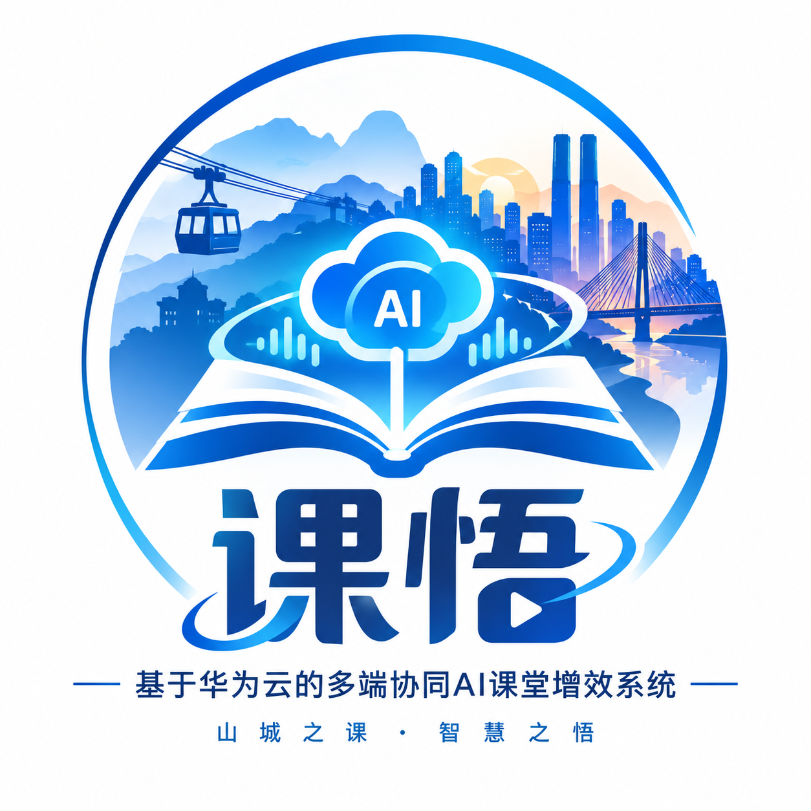

# 课悟 · Kewu

**基于华为云的多端协同 AI 课堂增效系统** · 华为 ICT 创新赛赛题 1

---

课堂里有个一直没被好好解决的问题：老师讲得快，学生记不住，课后复习没重点。课悟想用华为云的 AI 能力，把课堂内容实时转写、提炼、重组，变成每个学生手里"懂自己"的学习助手，并且在大屏、手机、平板之间保持同一份状态。

核心就三件事：**实时协同、AI 结构化、多端一致**。

## 核心功能

**实时协同批注** — 老师和学生在同一块画布上同步标记，延迟低到几乎没有感觉。

**AI 课堂纪要** — 语音转写加语义提炼，下课即出结构化的知识点清单。

**智能复习卡片** — 课后自动把内容重组成记忆卡片和知识图谱，按遗忘曲线提醒。

**多端一致体验** — 大屏、手机、平板共用一份状态，切换设备不丢上下文。

**流畅动画贯穿始终** — 从页面转场到卡片翻面，动效是体验的一部分，不是装饰。用 Material 3 的缓动与层次把每一帧打磨得顺滑。

> 📸 演示 GIF / 截图占位：课堂协同实机演示、复习卡片翻转动效

## 技术栈

- **华为云 CodeArts** — 项目协作与 DevOps 全流程
- **华为云 RDS** — 课堂数据持久化
- **华为云 Redis** — 协同会话的实时状态与缓存
- **Kotlin Multiplatform** — 一套业务逻辑，多端共享
- **Compose Multiplatform** — 统一 UI，Material 3 设计语言
- **WebSocket** — 多端实时同步的通信底座

## 开源协议

本项目采用 **MIT License**，欢迎同赛道交流，但请保留版权声明。

---

*课悟 · 让每一堂课都被记住*

